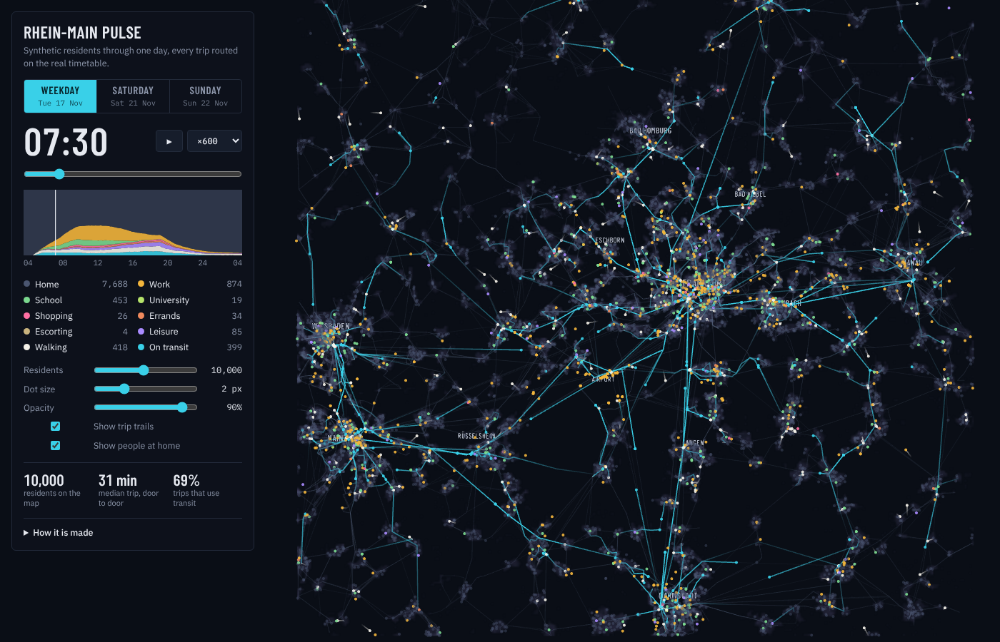

# Rhein-Main Pulse — a synthetic day of 20,000 residents

Interactive map: **https://ilyas-ku.github.io/rhein-main-pulse/**

20,000 synthetic residents of the Rhein-Main region go through a Tuesday, a Saturday and a
Sunday. Each one leaves home (or doesn't), goes to work, school, shops, errands or leisure, and
every trip is routed door to door on the real public transport timetable of that date.
Switch the day, scrub the clock, and change how many residents are shown, the dot size and the
opacity. Inspired by Erdoğan Taşkesen's
[Daily Life of Europeans](https://erdogant.github.io/docs/d3blocks/daily_life_of_european.html).



## How it is built

| Step | Source | Code |
|---|---|---|
| Timetable for Tue 17, Sat 21 and Sun 22 Nov 2026 inside the box 49.85–50.35 N, 8.20–9.00 E | DELFI GTFS via [gtfs.de](https://gtfs.de) | `pipeline/build_timetable.py` |
| Homes | Zensus 2022 population, ~200 m grid (from [rhein-main-transit-reach](https://github.com/Ilyas-ku/rhein-main-transit-reach)) | `data/grid.json` |
| Destinations: workplaces, schools, universities, shops, errands, escort trips, leisure | OpenStreetMap via Overpass | `fetch_pois.py` |
| Person types, who leaves home, number of trips, purposes, trip start times | [MiD 2023](https://www.mobilitaet-in-deutschland.de/publikationen2023.html) tables P36.1, P39.1, P39.2, W1, W7, W9 | `survey.py` |
| Time spent at work, shopping and errands, leisure | [ZVE 2022](https://www.destatis.de/DE/Themen/Gesellschaft-Umwelt/Einkommen-Konsum-Lebensbedingungen/Zeitverwendung/_inhalt.html) (Destatis 63911) | `survey.py` |
| Departure times fitted so that trip start times by purpose match MiD W7 (non-negative least squares) | | `gen.py` |
| Routing: earliest arrival, walk 4.8 km/h × 1.3 detour, stops within 1 km, transfers ≤ 400 m + 2 min | | `router.js` |

Each run prints, and the page shows, the model next to the survey: share leaving home,
trips per person and trip start times by time of day.

## Limits

- MiD and ZVE figures are national, not regional. MiD gives per-type values (share leaving
  home, trips, purposes) for all days together; they are scaled to each day by that day's row.
- Everyone travels by transit or on foot. Cars and bikes are not modelled.
- ZVE counts 4:51 of school lessons; the MiD return trips need about 7 h of presence at school,
  so the model uses the fitted value.
- "5 or more trips" is capped at 6, so trips per person on a Tuesday come out at 2.8 (MiD 3.2).
- Frankfurt Airport is set to about 5% of the work weight (≈80k jobs); escort stops last 10 min.
- Children under 6 are left out.

The picture illustrates the model; it is not a measurement.

## Rebuild

```sh
pip install duckdb numpy scipy
curl -LO https://download.gtfs.de/germany/free/latest.zip && unzip latest.zip -d feed
python3 pipeline/build_timetable.py feed data      # dates are set in the script
python3 fetch_pois.py https://maps.mail.ru/osm/tools/overpass/api/interpreter
for d in weekday saturday sunday; do python3 gen.py $d 20000; done
```

Data: DELFI / gtfs.de (CC BY-SA 4.0), Zensus 2022 (dl-de/by-2-0), © OpenStreetMap contributors
(ODbL), MiD 2023 (BMDV, infas), ZVE 2022 (Destatis).
